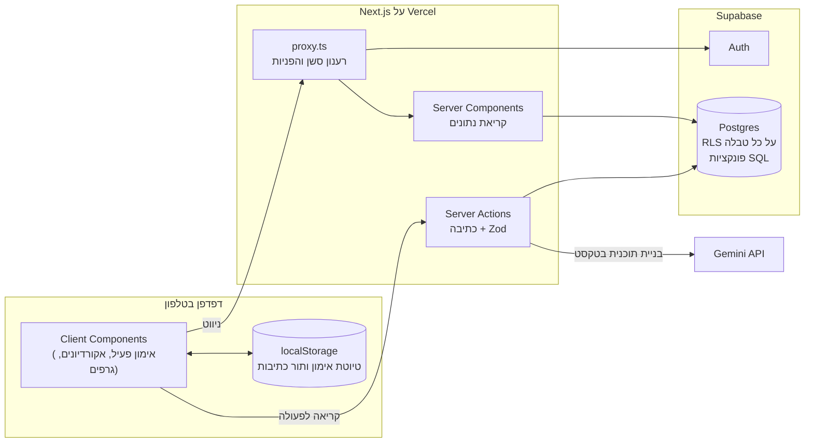
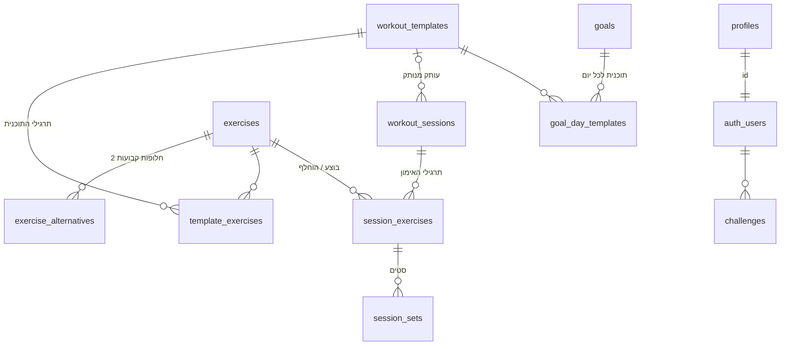

# יומן אימונים

אפליקציית ווב לתיעוד אימוני כוח בחדר הכושר, מותאמת לטלפון ולעבודה ביד אחת תוך כדי אימון.
בונים תוכניות אימון, מתעדים משקל וחזרות בהקשה אחת, מחליפים תרגיל בחלופה כשמכונה תפוסה,
ורואים סטריק, אתגר וגרף התקדמות. זה מעקב בלבד: בלי תזונה, בלי המלצות ובלי רכיב חברתי.

- **האפליקציה באוויר:** https://gym-girly.vercel.app (אפשר להתקין על מסך הבית, ראו [התקנה על הטלפון](#התקנה-על-הטלפון))
- **מסמך הבנייה:** [SPEC.md](SPEC.md) הוא מקור האמת לכל החלטות המוצר.
- **מערכת העיצוב:** [design-system/MASTER.md](design-system/MASTER.md).
- **הנחיות לעבודה עם Claude Code:** [CLAUDE.md](CLAUDE.md).

---

## תוכן עניינים

1. [מה האפליקציה עושה](#מה-האפליקציה-עושה)
2. [סטאק טכנולוגי](#סטאק-טכנולוגי)
3. [ארכיטקטורה](#ארכיטקטורה)
4. [מודל הנתונים](#מודל-הנתונים)
5. [זרימות מרכזיות](#זרימות-מרכזיות)
6. [מבנה התיקיות](#מבנה-התיקיות)
7. [עיצוב, RTL ועברית](#עיצוב-rtl-ועברית)
8. [הרצה מקומית](#הרצה-מקומית)
9. [בדיקות](#בדיקות)
10. [דיפלוי](#דיפלוי)
11. [התקנה על הטלפון](#התקנה-על-הטלפון)
12. [דברים שכדאי לדעת (gotchas)](#דברים-שכדאי-לדעת-gotchas)
13. [מגבלות ומה לא נבנה](#מגבלות-ומה-לא-נבנה)

---

## מה האפליקציה עושה

| מסך | נתיב | מה יש בו |
| --- | --- | --- |
| התחברות והרשמה | `/login`, `/signup` | מייל וסיסמה, או Google. נשארים מחוברים. |
| ברוכים הבאים | `/welcome` | אחרי ההתחברות הראשונה: שם (חובה) ומטרה (לא חובה). |
| בית (דשבורד) | `/` | התחלת אימון או חזרה לאימון פתוח, "היום" לפי המטרה עם הסטריק, אתגר, וגרף התקדמות לכל תוכנית. |
| אימון פעיל | `/workout/[id]` | שורה לכל תרגיל: ✓, שם, משקל וחזרות. הערכים מהפעם הקודמת או מהתוכנית מופיעים באפור, והקשה אחת מסמנת את כל התרגיל. אקורדיון עם הסבר, 2 חלופות, הפעם הקודמת, מספר סטים והערה. |
| סיכום אימון | `/workout/[id]/summary` | משך, תרגילים, סטים ונפח, והשוואה לפעם הקודמת באחוזים לכל תרגיל. |
| תוכניות | `/plans` | רשימת תוכניות, יצירה, שכפול, ארכוב, ו**בניית תוכנית בטקסט חופשי** עם עוזר AI. |
| עורך תוכנית | `/plans/[id]` | שורה לכל תרגיל, עריכה באקורדיון (סטים, משקל נוכחי, טווח חזרות, הערה) ושינוי סדר בגרירה. |
| היסטוריה | `/history` | לוח חודשי עם סטטוס לכל יום, ורשימת האימונים של החודש. |
| פרטי אימון | `/sessions/[id]` | עריכת משקל, חזרות וסטים של אימון שעבר, והסרת תרגיל או מחיקת האימון. |
| ספריית תרגילים | `/exercises`, `/exercises/[id]` | 140 תרגילים מובנים ותרגילים אישיים, חיפוש וסינון, 2 חלופות קבועות לכל תרגיל, והיסטוריה מלאה. |
| הגדרות | `/settings` | מטרה, אתגר, אתגרים קודמים והתנתקות. |

---

## סטאק טכנולוגי

| שכבה | בחירה |
| --- | --- |
| Framework | Next.js 16 (App Router, Cache Components, Partial Prefetching), React 19, TypeScript במצב strict |
| עיצוב ורכיבים | Tailwind CSS v4, shadcn/ui (על בסיס Base UI), Heroicons, פונט Assistant |
| גרפים | Recharts (נטען בעצלות) |
| גרירה | dnd-kit |
| מסד נתונים ואימות | Supabase: Postgres, Auth ו-RLS, דרך `@supabase/ssr` |
| ולידציה | Zod, בכל Server Action |
| תאריכים | date-fns |
| AI | Gemini (Interactions API), דרך `fetch` מהשרת |
| בדיקות | Vitest (יחידה ואינטגרציה), pgTAP (מסד), Playwright (זרימה מלאה) |
| דיפלוי | Vercel, מחובר ל-GitHub |

---

## ארכיטקטורה



### עקרונות

- **קריאה בשרת, כתיבה ב-Server Actions.**
  - דפים הם Server Components שקוראים מ-Supabase.
  - כל כתיבה עוברת דרך Server Action שקורא ל-`getCurrentUser()` ומוודא את הקלט עם Zod. הסכמות נמצאות ב-`src/lib/validation/`.
- **ההרשאות במסד, לא רק בקוד.**
  - RLS מופעל על כל טבלה, וכל משתמש רואה וכותב רק את השורות שלו.
  - בטבלאות בנות, ההרשאה נגזרת מהשורה ההורה.
  - כל הפונקציות ב-SQL הן `security invoker`, ולכן גם הן כפופות ל-RLS.
- **פעולות של כמה שורות הן פונקציות SQL אטומיות.** למשל: התחלת אימון מתוכנית, שמירת אימון, שכפול תוכנית, שינוי מטרה ושמירת כל הסטים של תרגיל.
- **החישובים הם פונקציות טהורות עם בדיקות.**
  - הם נמצאים ב-`src/lib/calc/`: e1RM, הביצוע הקודם, סטטוס יום, סטריק, אתגר, התקדמות וסיכום.
  - הם לא ניגשים למסד ולא תלויים בשעון: "היום" מגיע תמיד כפרמטר.
- **"היום" נקבע לפי המכשיר.** הימים נספרים לפי אזור הזמן של הדפדפן (SPEC.md). לכן:
  - השרת מספק רק נתונים גולמיים.
  - הדשבורד, הלוח, הסטריק והאתגר מחושבים בדפדפן, עם `useToday()`.
  - בדפים שהשרת מרנדר מוצג `session_date`, התאריך שנרשם במכשיר.
- **מסך האימון לא מאבד נתונים.**
  - כל שינוי מופיע מיד ונכנס לתור כתיבות שמאחד פעולות כפולות (`queue.ts`), עם ניסיונות חוזרים (`sync-engine.ts`).
  - התור ותמונת המסך נשמרים ב-localStorage, ואחרי רענון הם נטענים ונשלחים שוב.
  - כל המזהים נוצרים בדפדפן, ולכן שליחה חוזרת לא יוצרת כפילויות.
- **המפתחות לא מגיעים לדפדפן.** בדפדפן יש רק את ה-publishable key של Supabase, ש-RLS מגן עליו. מפתח Gemini נשאר בצד השרת בלבד.

---

## מודל הנתונים



**ההבחנה המרכזית:** תוכנית (`workout_templates`) היא מה שמתכננים, ואימון (`workout_sessions`) הוא מה שקרה בפועל. אימון הוא עותק מנותק של התוכנית, ולכן שינוי בתוכנית לא משנה אימונים שכבר קרו. כל ההיסטוריה מחושבת לפי `exercise_id` של התרגיל שבוצע בפועל.

| טבלה | תפקיד |
| --- | --- |
| `profiles` | השם (`display_name`, נקבע במסך ברוכים הבאים), ושם משתמש לחשבונות ישנים. נוצרת אוטומטית בהרשמה, על ידי ה-trigger `handle_new_user`. |
| `exercises` | התרגילים. `user_id = null` הוא תרגיל מובנה (140 ב-seed, כולל חימום, מתיחות ואמות), ואחרת תרגיל אישי. אפשר לארכב. |
| `exercise_alternatives` | 2 חלופות קבועות לכל תרגיל, לפי עדיפות. |
| `workout_templates`, `template_exercises` | תוכנית ותרגיליה: סטים, טווח חזרות, הערה ו"משקל נוכחי" (`target_weight_kg`). |
| `workout_sessions` | אימון: `in_progress` או `completed`. לכל משתמש יש לכל היותר אימון פתוח אחד. |
| `session_exercises`, `session_sets` | תרגילי האימון וסטים. בתרגיל שהוחלף, `replaced_exercise_id` שומר את התרגיל המקורי. |
| `goals`, `goal_day_templates` | מטרה של ימים קבועים או מחזור. מטרה שהוחלפה מקבלת `end_date`, ולכל משתמש יש מטרה פעילה אחת. |
| `challenges` | אתגר של X שבועות ברצף, עם סטטוס פעיל, הצליח או נכשל. |

**פונקציות SQL (`supabase/migrations/`):**

| פונקציה | מה היא עושה |
| --- | --- |
| `start_session` | יוצרת אימון מתוכנית או אימון חופשי, ומעתיקה את התרגילים עם סטים ריקים. |
| `save_session_exercise_sets` | כותבת את כל הסטים של תרגיל בקריאה אחת, עם אותו משקל ואותן חזרות. |
| `complete_session` | מוחקת סטים שלא בוצעו ותרגילים ריקים, ממספרת מחדש, מעדכנת את "המשקל הנוכחי" בתוכנית ומסמנת את האימון כהושלם. |
| `previous_performance` | הסטים של האימון האחרון שהושלם עבור כל תרגיל, אופציונלית עד תאריך מסוים (`p_before`). |
| `duplicate_template`, `reorder_template_exercises`, `archive_template` | ניהול תוכניות. ארכוב מסיר גם את השיבוץ של התוכנית ליום במטרה. |
| `purge_archived_templates` | רצה כל לילה ב-01:00 UTC (`pg_cron`, המשימה `purge-archived-plans`) ומוחקת תוכניות שבארכיון יותר מ-30 יום. `archived_at` מתעדכן לבד מ-`is_archived` (trigger). האימונים נשמרים, כי `template_id` מתאפס ושם התוכנית שמור באימון. |
| `set_goal`, `start_challenge` | החלפת מטרה (הקודמת מסתיימת אתמול) ופתיחת אתגר. |
| `set_exercise_alternatives`, `exercise_in_use` | חלופות לתרגיל אישי, ובדיקה אם אפשר למחוק תרגיל. |

**מה לא נשמר:** הסטריק, סטטוס הימים, ההתקדמות והסיכומים מחושבים כל פעם מחדש מהנתונים. החריג היחיד הוא תוצאת האתגר, שנרשמת כשהוא מסתיים.

---

## זרימות מרכזיות

### הרשמה והתחברות
- **מייל וסיסמה:** `supabase.auth.signUp` ו-`signInWithPassword`. אימות המייל כבוי, אז נכנסים מיד.
- **Google:**
  - הכפתור מריץ את `signInWithOAuth`, ו-Google חוזר ל-`/auth/callback` (`src/app/auth/callback/route.ts`), שמחליף את הקוד בסשן.
  - המפתחות של Google מוגדרים רק בדשבורד של Supabase (Authentication → Providers → Google), לא באפליקציה ולא ב-Vercel.
- **חשבונות ישנים:** אפשר להזין בשדה המייל את שם המשתמש הישן, והוא מתורגם למייל הפנימי (`toAuthEmail`).
- **מסך ברוכים הבאים:**
  - בהרשמה, ה-trigger `handle_new_user` יוצר שורה ב-`profiles` בלי שם.
  - כל עוד אין `display_name`, הרכיב `RequireName` ב-layout של האפליקציה מעביר ל-`/welcome`.
  - שם: חובה, ומלא מראש מ-Google. מטרה: לא חובה.
- **פרופיל או חשבון שנמחקו:** טוקן תקין בלי שורה ב-`profiles` נשלח ל-`/auth/reset`. אם החשבון עדיין קיים, הפרופיל נוצר מחדש ומסך ברוכים הבאים מופיע. אם החשבון נמחק, הסשן מתנקה ועוברים להתחברות. בלי זה, `/` ו-`/login` היו שולחים זה לזה בלולאה.
- **הגנה על הדפים:** `proxy.ts` מרענן את הסשן ומעביר משתמש לא מחובר ל-`/login`. בנוסף, כל דף וכל פעולה בודקים שוב עם `getCurrentUser()`.

### אימון
1. **התחלה:** "התחלת אימון" קורא ל-`start_session`, עם התאריך המקומי של המכשיר.
2. **הצעות:** המשקל המוצע לכל תרגיל הוא המשקל הנוכחי מהתוכנית, ואם אין, המשקל מהפעם הקודמת. החזרות מגיעות מהפעם הקודמת, ואם אין, מתחילת טווח החזרות.
3. **סימון:** הקשה על ✓ מסמנת את כל הסטים של התרגיל עם אותם ערכים, דרך פעולת `saveSets` בתור.
4. **החלפה:** החלופות מגיעות מהספרייה. לחלופה יש היסטוריה משלה, והתרגיל המקורי נשמר ב-`replaced_exercise_id`.
5. **שמירה:** `complete_session` מסיים את האימון ופותח את הסיכום. "המשקל הנוכחי" בתוכנית מתעדכן לבד, אבל לא עבור תרגיל שהוחלף.

### דשבורד
מחושב כולו בדפדפן מ-`getGoalData()`:
- `getDayStatus` ← `currentStreak` ו-`longestStreak`.
- `evaluateChallenge` ← וכשהאתגר מסתיים, `settleChallenge` רושם את התוצאה בשרת.
- `computeProgress` ← הגרף לכל תוכנית.

### בניית תוכנית בטקסט חופשי (AI)
1. השיחה, הטיוטה והספרייה נשלחות ל-Gemini, עם מספרים קצרים במקום מזהים ארוכים.
2. התשובה חוזרת כ-JSON לפי סכמה.
3. `sanitizeDraft` מנקה אותה: רק תרגילים קיימים, ומספרים בטווחי התוכנית.
4. "סיום" שומר את הטיוטה כתוכנית חדשה.

כשהמודל עמוס, המערכת עוברת למודל קל יותר.

---

## מבנה התיקיות

```
src/
  proxy.ts                    רענון סשן והפניות (מה שהיה middleware לפני Next 16)
  app/
    layout.tsx                <html lang="he" dir="rtl">, פונט, Toaster
    globals.css               הטוקנים של מערכת העיצוב (Tailwind v4 + shadcn)
    manifest.ts, icon.png, apple-icon.png   PWA
    (auth)/login, (auth)/signup
    (app)/                    כל מה שמאחורי התחברות, עם סרגל ניווט תחתון
      page.tsx                בית / דשבורד
      workout/[id], workout/[id]/summary
      plans, plans/[id]
      history, sessions/[id]
      exercises, exercises/[id]
      settings
  components/
    ui/                       רכיבי shadcn, מותאמים לטוקנים (button, input, drawer, dialog…)
    shared/                   Sheet, ConfirmDialog, EmptyState, Chip, ListSkeleton…
    layout/                   BottomNav, TopBar
    auth/  workout/  plans/  exercises/  history/  dashboard/  progress/
  lib/
    strings.ts                כל הטקסטים בעברית, במקום אחד
    calc/                     פונקציות חישוב טהורות + בדיקות
    validation/               סכמות Zod
    supabase/                 clients לשרת ולדפדפן, proxy, טיפוסים שנוצרו מהמסד
    auth/  exercises/  plans/  workout/  history/  dashboard/  progress/  ai/
                              לכל תחום: queries.ts (קריאה), actions.ts (Server Actions)
                              ולוגיקה טהורה עם בדיקות
    workout/queue.ts, sync-engine.ts, storage.ts   תור הכתיבות של מסך האימון
    use-today.ts, use-on-hidden.ts, format-date.ts
supabase/
  migrations/                 הסכמה, RLS ופונקציות, לפי סדר
  seed.sql                    140 תרגילים מובנים ו-280 חלופות
  tests/                      בדיקות pgTAP
tests/integration/            בדיקות אינטגרציה מול Supabase המקומי
e2e/main-flow.spec.ts         בדיקת הזרימה המלאה (Playwright)
design-system/MASTER.md       החלטות העיצוב של הפרויקט
```

---

## עיצוב, RTL ועברית

- **מערכת העיצוב:** "Blush Porcelain", מהסקיל האישי של Adi. הצבעים, הטיפוגרפיה והפינות מוגדרים כטוקנים ב-`globals.css`. ההחלטות שנוגעות לפרויקט הזה כתובות ב-`design-system/MASTER.md`.
- **ערכה בהירה בלבד:** משטחים לבנים וורודים, כפתור ראשי בסגול כהה, ופונט Assistant.
- **מימין לשמאל:** `<html dir="rtl">`, ורק מאפיינים לוגיים של Tailwind (`ms-`, `pe-`, `start-`). שדות מספר וגרפים הם משמאל לימין.
- **מובייל קודם:** הממשק מתוכנן לרוחב 360 עד 430px. יעדי הלחיצה הם 44px לפחות, וכפתורי הפעולה נמצאים באזור האגודל.
- **טקסטים:** כל הטקסט בממשק נמצא ב-`src/lib/strings.ts`. הניסוח ניטרלי מגדרית, והכפתורים נקראים בשמות פעולה ("שמירה", "סיום").

---

## הרצה מקומית

**דרישות מוקדמות:**
- Node.js 22 ומעלה.
- [Supabase CLI](https://supabase.com/docs/guides/local-development/cli/getting-started).
- Docker פעיל, בשביל Supabase מקומי.

```bash
npm install
cp .env.example .env.local   # ממלאים את הערכים (ראו בהמשך)
supabase start               # מרים Postgres + Auth מקומיים, מריץ migrations ו-seed
npm run dev                  # http://localhost:3000
```

### משתני סביבה

| משתנה | מאיפה | הערה |
| --- | --- | --- |
| `NEXT_PUBLIC_SUPABASE_URL` | מקומי: `http://127.0.0.1:54321`. בענן: Project Settings → API | ציבורי |
| `NEXT_PUBLIC_SUPABASE_PUBLISHABLE_KEY` | מקומי: `supabase status`. בענן: Project Settings → API | ציבורי, ומוגן ב-RLS |
| `GEMINI_API_KEY` | Google AI Studio | **בצד השרת בלבד.** בלעדיו העוזר מציג שהוא לא מוגדר. |
| `GEMINI_MODEL` | — | אופציונלי. בלי ערך, האפליקציה משתמשת ב-`gemini-3.8-flash`, ועוברת לגיבוי כשהוא עמוס. |

### מסד הנתונים

| פקודה | מה היא עושה |
| --- | --- |
| `npm run db:reset` | בונה את המסד המקומי מאפס: כל ה-migrations, ואחריהן ה-seed |
| `npm run db:test` | בדיקות pgTAP |
| `npm run db:types` | יוצר מחדש את טיפוסי TypeScript מהמסד המקומי |

**אחרי שינוי סכמה:**
1. `supabase migration new <name>`.
2. `npm run db:reset`.
3. `npm run db:types`.

---

## בדיקות

| פקודה | מה נבדק | כמה |
| --- | --- | --- |
| `npm test` | Vitest: חישובים, ולידציה, תור הכתיבות, הצעות, לוח, ניקוי פלט ה-AI | 210 |
| `npm run test:integration` | משתמשים אמיתיים מול Supabase המקומי: בידוד בין משתמשים, תוכניות, אימונים | 23 |
| `npm run db:test` | pgTAP: RLS, ה-seed, וכל פונקציות ה-SQL, מחיקת הארכיון | 99 |
| `npm run test:e2e` | Playwright: הרשמה, מדריך מסך הבית, תוכנית, שני אימונים עם הצעות, החלפה לחלופה, סיכום ולוח | 1 זרימה |
| `npm run typecheck`, `npm run lint`, `npm run build` | טיפוסים, ESLint ו-build | — |

כל הבדיקות שיוצרות משתמשים רצות רק מול Supabase המקומי, אף פעם לא מול הענן.
בדיקת ה-e2e בונה ומריצה את האפליקציה על פורט 3100, ולכן היא לא מתנגשת עם `npm run dev`.
העוזר בודק את הלוגיקה שלו בלבד, בלי קריאות אמיתיות ל-Gemini, כי המכסה החינמית מוגבלת.

---

## דיפלוי

- **Vercel:** פרויקט `gym-girly`, מחובר ל-repo [adiozana/gym_girly](https://github.com/adiozana/gym_girly). כל push ל-`main` מעלה גרסה חדשה.
- **משתני סביבה ב-Vercel:** אלה שב-`.env.example`, עם הערכים של פרויקט Supabase בענן ("Gym Tracker").
- **שינויי סכמה עולים לענן בנפרד:**
  ```bash
  supabase db push --linked                 # migrations
  supabase db query --linked -f supabase/seed.sql --yes  # כשהספרייה המובנית משתנה (בטוח להריץ שוב)
  ```
- **הגדרות Auth בענן (Supabase → Authentication):**
  - **Providers:**
    - Email: Confirm email כבוי, ואורך סיסמה מינימלי 8.
    - Google: מופעל, עם Client ID ו-Secret.
  - **URL Configuration:**
    - Site URL: `https://gym-girly.vercel.app`.
    - Redirect URLs: `https://gym-girly.vercel.app/**`, `http://localhost:3000/**` ו-`https://gym-girly-*-adiozanas-projects.vercel.app/**`.
- **Google Cloud Console (OAuth client):**
  - Authorized redirect URI: `https://zaosoubunwsslfrrrfky.supabase.co/auth/v1/callback`.
  - Authorized JavaScript origins: כתובת האפליקציה ו-`http://localhost:3000`.

---

## התקנה על הטלפון

1. פותחים את https://gym-girly.vercel.app בטלפון.
2. אחרי ההתחברות נפתח מדריך עם השלבים לטלפון (פעם אחת בכל מכשיר; אפשר לפתוח אותו שוב מההגדרות). בקצרה: **iPhone:** כפתור השיתוף ← "הוספה למסך הבית". **Android:** ב-Chrome, תפריט ⋮ ← "התקנת אפליקציה", או כפתור "התקנה" שבמדריך.
3. פותחים מהאייקון. האפליקציה נפתחת במסך מלא, מימין לשמאל.

---

## דברים שכדאי לדעת (gotchas)

- **Next.js 16 שונה ממה שמכירים.** לפני שכותבים קוד של Next כדאי לבדוק ב-`node_modules/next/dist/docs/` (ראו `AGENTS.md`).
  - `middleware` נקרא עכשיו `proxy`.
  - ל-`error.tsx` מגיע `retry`.
  - `params` הוא Promise.
- **Cache Components:**
  - כל מה שקורא את הסשן צריך להיות בתוך `<Suspense>`.
  - ה-client של Supabase בשרת קורא ל-`connection()`.
  - `usePathname` בנתיב דינמי צריך Suspense.
- **Activity:**
  - Next שומר דפים שעזבנו כשהם מוסתרים, עם ה-state שלהם. חלונית או דיאלוג שנשארו פתוחים "נועלים" את הדף הבא.
  - `Sheet` ו-`ConfirmDialog` מתאפסים לבד. לכל state זמני אחר משתמשים ב-`useOnHidden()`.
  - בבדיקות דפדפן כדאי לחפש רק רכיבים גלויים (`:visible`), כי הדף המוסתר עדיין ב-DOM.
- **dnd-kit:** צריך `id` יציב מ-`useId()`, אחרת יש אי-התאמה בין השרת לדפדפן.
- **Gemini:**
  - מודלים ישנים ו-`generateContent` סגורים למפתחות חדשים, ולכן משתמשים ב-Interactions API.
  - במכסה החינמית יש עומסים (503). הם לא נספרים במכסה, והקוד עובר למודל קל יותר.
- **Supabase CLI:** החיבור ל-pooler של הענן נופל לפעמים. ניסיון נוסף בדרך כלל מצליח.
- **ה-seed לא רץ שוב בענן:** `db push --include-seed` מדלג על seed שכבר נטען פעם אחת. לכן, אחרי שמוסיפים תרגילים מובנים, מריצים אותו ישירות:
  ```bash
  supabase db query --linked -f supabase/seed.sql --yes
  ```
  זה בטוח להריץ שוב ושוב, כי כל ההכנסות הן `on conflict do nothing`.
- **המשימה הלילית (`pg_cron`):** בודקים שהיא קיימת ומתי רצה עם `select * from cron.job;` ו-`select * from cron.job_run_details order by start_time desc limit 5;`.

---

## מגבלות ומה לא נבנה

לפי SPEC.md, אלה לא חלק מה-MVP:
- שחזור סיסמה, התחברות עם Google, מחיקת חשבון.
- טיימר מנוחה, RPE ו-RIR, סטי חימום.
- רישום אימון בדיעבד ושינוי תאריך של אימון.
- שיאים אישיים וגרף לכל תרגיל.
- עבודה מלאה בלי חיבור לאינטרנט (יש תור כתיבות שעומד בניתוקים קצרים), התראות.
- יחידות אחרות מלבד ק"ג.
- שיתוף, חברים ותזונה.

**הערה על המודל:** משקל וחזרות נרשמים לכל תרגיל, לא לכל סט (החלטת מוצר אחרי שלב 3). כל סט עדיין נשמר כשורה נפרדת, כך שהחישובים והגרפים עובדים כרגיל.
